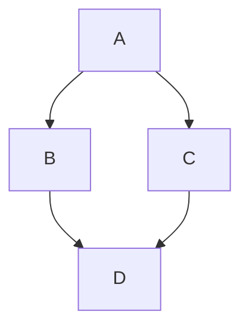

+++
date = '2026-11-06T03:51:26Z'
title = 'Test Content'
tags = ["test", "markdown"]
categories = ["Misc"]
+++

Here is an *article* with **bold** test and [links](example.com).

```sh
sudo apt install opsec
```

Here is a simple flow chart using mermaid syntax:


